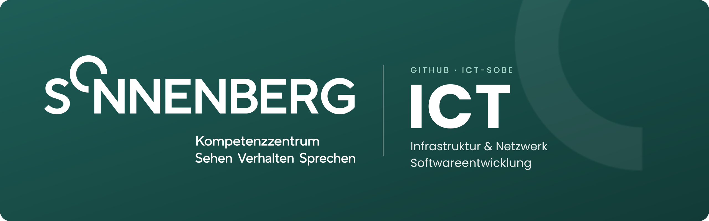

  

  <b>Willkommen bei der ICT des Kompetenzzentrums SONNENBERG.</b> 
  Hier entwickeln und betreuen wir die Informatik für unsere Standorte in Baar, Menzingen und Kloten.

---

## Über SONNENBERG

> *«Wir begleiten, fördern und unterstützen mit Herz!»*

SONNENBERG ist ein sonderpädagogisches Kompetenzzentrum für Kinder, Jugendliche und Erwachsene mit einer Beeinträchtigung im Bereich **Sehen**, **Verhalten** oder **Sprechen**. Unser Ziel ist es, den Klient*innen ein selbstbestimmtes und eigenständiges Leben zu ermöglichen.

**Bedürfnisse erkennen – Selbstständigkeit fördern – Lebensfreude schaffen**

| Standort | Schwerpunkt |
|---|---|
| **Baar** (ZG) | Hauptstandort |
| **Menzingen** (ZG) | Verhalten Plus, Wohnangebot Erwachsene Sehen Plus |
| **Kloten** (ZH) | Low-Vision-Abklärungen, heilpädagogische Früherziehung |

## Unsere ICT

Die ICT sorgt dafür, dass alle Mitarbeitenden an unseren Standorten zuverlässig, sicher und einfach arbeiten können. So bleibt mehr Zeit für das, was bei SONNENBERG im Zentrum steht: die Menschen.

<table>
<tr>
<td width="50%" valign="top">

### Infrastruktur & Netzwerk

Netzwerk, WLAN und die Vernetzung unserer Standorte. Dazu Server, Arbeitsplätze, Backup und IT-Sicherheit.

</td>
<td width="50%" valign="top">

### Softwareentwicklung

Eigene Tools, Automatisierungen und Skripte, die Abläufe im Alltag vereinfachen, sowie Schnittstellen zwischen unseren Systemen.

</td>
</tr>
</table>

## Mehr erfahren

[Website](https://www.sonnenberg-baar.ch) · [Kontakt](https://www.sonnenberg-baar.ch/kontakt/) · [Offene Stellen](https://www.sonnenberg-baar.ch/jobs/)

 

  Verein SONNENBERG Baar · Landhausstrasse 20 · 6340 Baar · <a href="https://www.sonnenberg-baar.ch">sonnenberg-baar.ch</a>

